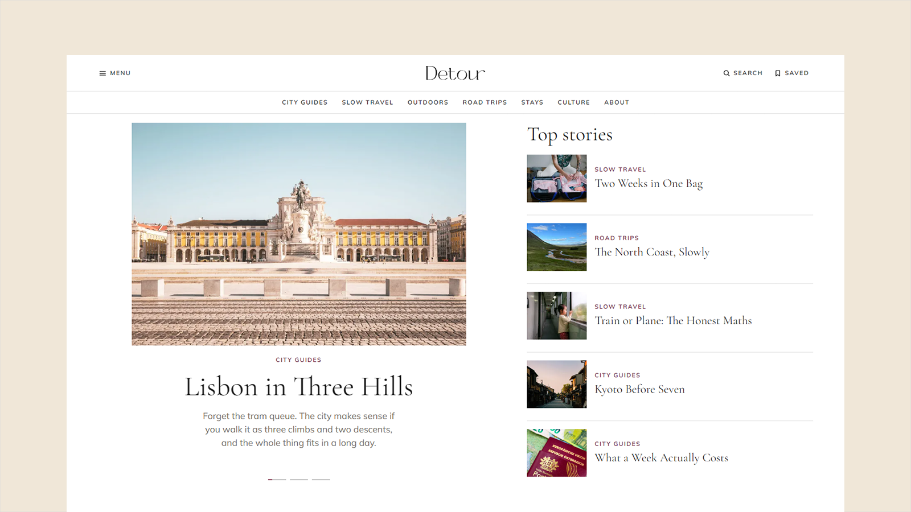

# Detour - Astro Travel Magazine Theme

[](https://detour.xocoweb.workers.dev/)

[](https://astro.build/)
[](https://tailwindcss.com/)
[](https://www.typescriptlang.org/)
[](./LICENSE)

**Live preview:** https://detour.xocoweb.workers.dev/

Detour is a premium Astro theme for travel blogs and magazines. Stories are written in Markdown or MDX, validated at build time, and published as a fully static site with no framework runtime. The front page, archives, feeds, search index and share cards are all generated from the posts, so adding a story is adding one folder.

## Features

- A 1500px centred layout on a white page, with full-bleed blocks that stop at the same measure
- A front page assembled from the archive with no repeats: a three-story slider that auto-rotates and pauses on hover or focus, the most-read beside it, card grids, a tinted topics sentence, a poster wall of editor's picks, and a section browser — every block hides itself when it has nothing to show
- A section browser rendered as plain panels on the server and upgraded to tabs by script, so it works with JavaScript off
- A tint per section, carried on the topics sentence, the section browser and the section page header
- Four card variants — `card`, `poster`, `compact`, `plain` — differing in crop and in how much text they carry
- Read time counted from the post body at build time, and a `place` field for where a story was filed from, both printed in the article header
- A header of Menu, logo, Search and Saved over a bar of sections, which hides on scroll and returns as the first row only, plus a focus-trapped drawer with every section, page and post layout
- Six article openings set per post — `standard`, `split`, `banner`, `parallax`, `cover`, `immersive` — sharing one title block. The parallax strip moves its photograph on a view timeline with no scroll listener, and the site menu offers a live example of each
- Archive, section, tag, and author pages built from one entry — cover, headline, standfirst, then the section and the date on one line — as a three-across card grid or an image-led list, set per section
- A Filters button on the archive and section pages opening a dialog of two dropdowns — section and length — that work across the whole archive from the search index, with the state kept in the URL
- Client-side search with a keyboard palette (`/` or `⌘K`) and a results page, both reading one build-time index, ranked in tiers and matched on word starts
- Saved stories: a per-browser reading list from any article, read back at `/saved/`, with no accounts or backend
- A feed for everything, one per section, and one per author, carrying full content
- Every image in an article opens in a shared lightbox, whether written as plain Markdown or as a `Figure` or `Gallery` component
- Markdown and MDX content collections with a validated frontmatter schema, drafts excluded from every listing, feed, and index
- Sections, tints, navigation, the byline, and SEO defaults in config files, so the site can be renamed and re-scoped without touching a component
- Provider-neutral newsletter and contact forms — point them at any endpoint that accepts a POST, or leave them off
- Per-post share cards cropped from each cover at build time, plus canonical URLs, sitemap, RSS, `robots.txt`, Open Graph, Twitter/X cards, and JSON-LD
- Two self-hosted variable fonts, Cormorant Garamond for headings and Mulish for everything else, with no external font requests, and an inline SVG logo replaced by editing one file
- Static output with no framework islands; JavaScript only for search, the drawer, the filters, the section browser, the slider, the lightbox, saved stories, the share sheet, and the progress bar
- CSS-only scroll-driven motion with a fallback, flattened under `prefers-reduced-motion`
- Skip link, landmarks, labelled controls, visible focus states, and one tab stop per archive entry

## Tech Stack

- Astro 7 with MDX
- Tailwind CSS 4 via the Vite plugin
- Vite 8, TypeScript, Astro content collections
- `@astrojs/sitemap`, `@astrojs/rss`, Sharp
- Self-hosted Mulish and Cormorant Garamond fonts, and a local Bootstrap Icons set with its license notice

## Requirements

- Node.js `22.12.0` or newer
- npm

## Getting Started

```bash
npm install
npm run dev
```

Build for production:

```bash
npm run build
```

Preview the production build locally:

```bash
npm run preview
```

Before shipping a change, run type checking, the production build, and the formatter check together:

```bash
npm run release:check
```

## Customization

See [CUSTOMIZATION.md](./CUSTOMIZATION.md) for site settings, sections and their tints, the front page blocks, the header and menu, archive filters, images, search, feeds, forms, motion, and the theme's design tokens.

Set `siteConfig.siteUrl` in [src/config/site.ts](./src/config/site.ts) before building — canonical URLs, share images, the sitemap, and the feeds are all derived from it. The build is static, so any host that serves a directory works: `wrangler.jsonc` is included for Cloudflare Workers, and Netlify, Vercel, GitHub Pages, and object storage behind a CDN need no configuration beyond `npm run build`.

## Content

Posts live in [src/content/posts](./src/content/posts). Each post is a folder with an `index.md` (or `index.mdx`) and a `cover.jpg` beside it, validated by the schema in [src/content.config.ts](./src/content.config.ts).

The bundled demo content is fictional and the bylines are invented — **replace them before launch.** Demo photography comes from [Pexels](https://www.pexels.com/) under the [Pexels License](https://www.pexels.com/license/), and every cover and inline image carries its photographer and source URL. The author portrait is an Unsplash placeholder of a model with no connection to the fictional byline.

## Support

See [SUPPORT.md](./SUPPORT.md) for what a license includes, and [CHANGELOG.md](./CHANGELOG.md) for release history.

## License

Commercial license. See [LICENSE](./LICENSE) for complete terms.
