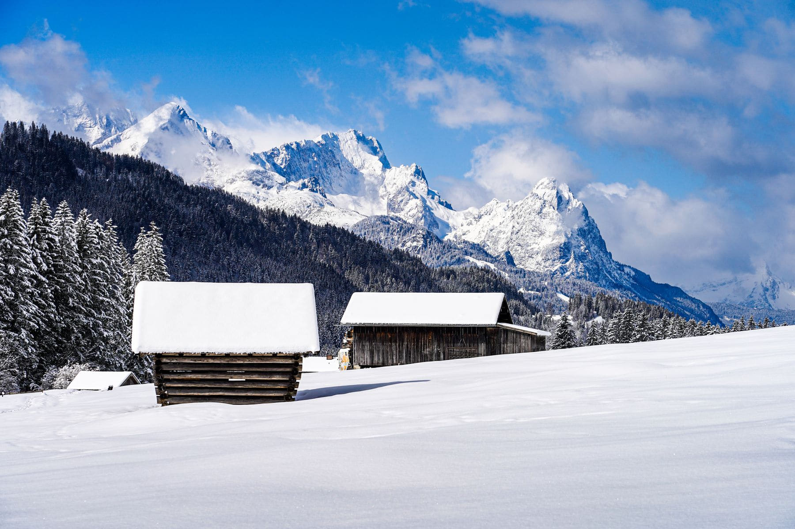

The listing said "40 min walk from parking". We read it as a detail. It is not a
detail; it is the entire character of the place, and it decides what you eat,
what you wear and how you spend the first evening.

Everything arrives on your back. Four days of food, which is heavier than you
think, and firewood if the shed is low, which it will be. In exchange you get
something genuinely rare in Europe, which is a building with no other building
visible from it.

_The same kind of place in March, when the walk in becomes a ski in. Photo: Landsmann._

## What you have to think about

- **Water.** From a stream, boiled, or carried. Ask which before you book.
- **Heat.** A wood stove that takes an hour to make a difference, so light it
  before you unpack rather than after.
- **Dark.** From October it is dark at four, and there is no light switch.
- **Waste.** You carry it out. All of it.

> Nothing recalibrates a week like an evening where the only decisions available
> are the fire and what to cook on it.

## Booking one

The Norwegian trekking association runs hundreds of huts on this model, some
staffed, most not, some unlocked with a standard key you buy for the season.
Private hytter go on the usual sites. Read the access line in the listing first
and the photographs second — it is the only sentence that matters.
