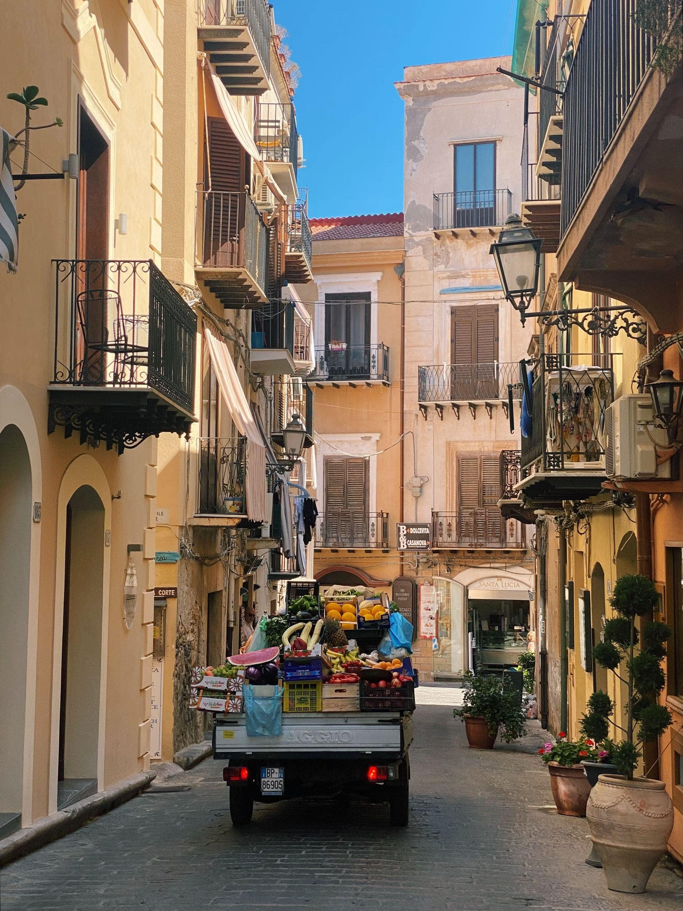

The first week you behave like a tourist. You see the things, you walk too far,
you photograph the same square from four corners. That is fine and it takes
about six days to run out.

The second week is the strange one. There is nothing left to see and three weeks
left to be there, and this is where most people would have gone home. Instead
you start buying bread at the same place, and the bread place starts keeping one
back for you, and something shifts.

_The street we walked twice a day for a month and never photographed until week three. Photo: Melanie Rispo._

## What a month buys

- **Weather.** You see the place in three kinds, not one. A town in rain is a
  different town.
- **A routine,** which sounds like the opposite of travel and is the thing you
  remember.
- **Prices that settle.** After a fortnight you know what things cost, which is
  the end of the low-level suspicion that follows tourists around.

> A fortnight across five towns gives you five first impressions. A month in one
> gives you a second impression, and the second one is where places are.

## The honest downside

You will be bored. Somewhere around day eleven the boredom arrives and it is
real and it is uncomfortable, and the only way through it is not to book a train
somewhere. On the other side of it is the part everybody writes about.
