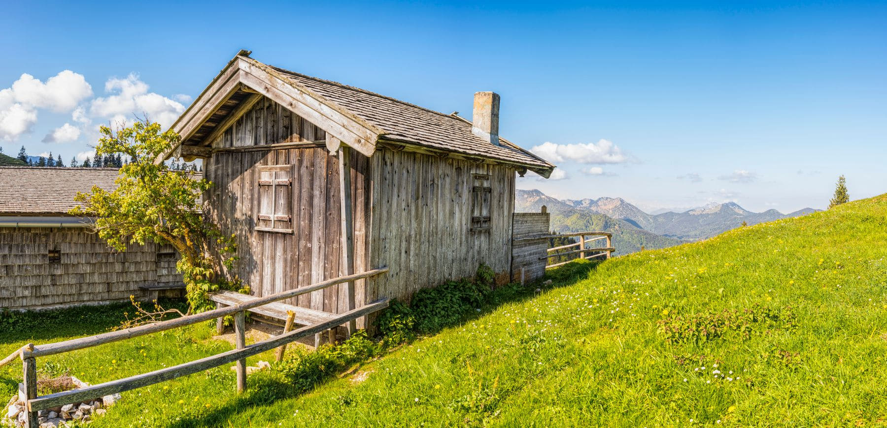

People hear "mountain hut" and picture a bothy: a stone room, a wooden platform,
bring your own everything. A _rifugio_ in the Dolomites is not that. It has a
kitchen, a wine list, hot showers on a timer, and a dining room that at seven in
the evening is as loud as any restaurant in Bolzano.

The half-board rate covers a bunk, dinner and breakfast. Dinner is three courses
and it arrives at a set time for everybody at once, which is part of the point:
you eat with whoever walked in that day.

_The hut we should have booked and did not, an hour further along the ridge. Photo: Felix Mittermeier._

## What is included and what is not

- **Included:** bunk, blanket, pillow, dinner, breakfast.
- **Not included:** sheets. You bring a liner, every time, and they will sell
  you a paper one at a mark-up if you forget.
- **Not included:** water, in some huts. Everything is carried or helicoptered
  up, and a bottle can cost what a beer costs.
- **Rarely included:** a working card machine.

> The lights go out at ten. This is not a suggestion and nobody who has walked
> seven hours will be on your side about it.

## Booking

Open in mid-March for the summer, full by May for August weekends, and the good
ones on the high routes go first. Email, do not phone. Confirm a week before.
Cancel properly if your plans change, because somebody on a four-day traverse is
waiting for the bed.
