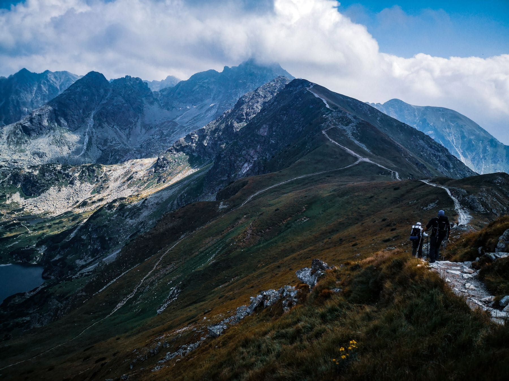

A good ridge walk is mostly a transport problem. The walking itself is
straightforward — you go up, you stay high for several hours, you come down —
but the up and the down are rarely in the same place, and the difference between
a brilliant day and a long one is whether you solved that before you started.

Solve it with a bus, a lift, or two cars. Solve it badly and you will walk an
out-and-back, which means seeing everything twice and spending the last two
hours retracing the least interesting section.

_The middle third, which is the entire reason for the other two. Photo: Monika Balciuniene._

## What makes a ridge worth it

- **A long level middle.** Anything over three kilometres of staying high.
- **Two different valleys,** one on each side. A ridge with the same view twice
  is a hill.
- **An escape route** at the halfway point, so weather does not mean turning
  back the whole way.

> The best measure of a ridge is not the height. It is how much of the day you
> spend above the treeline, and how little of it you spend getting there.

## Timing

Leave an hour earlier than the guidebook says. Not because you are slow, but
because afternoon cloud builds from about two in most ranges in summer, and the
difference between a 6am start and an 8am one is whether you see anything from
the top at all.
