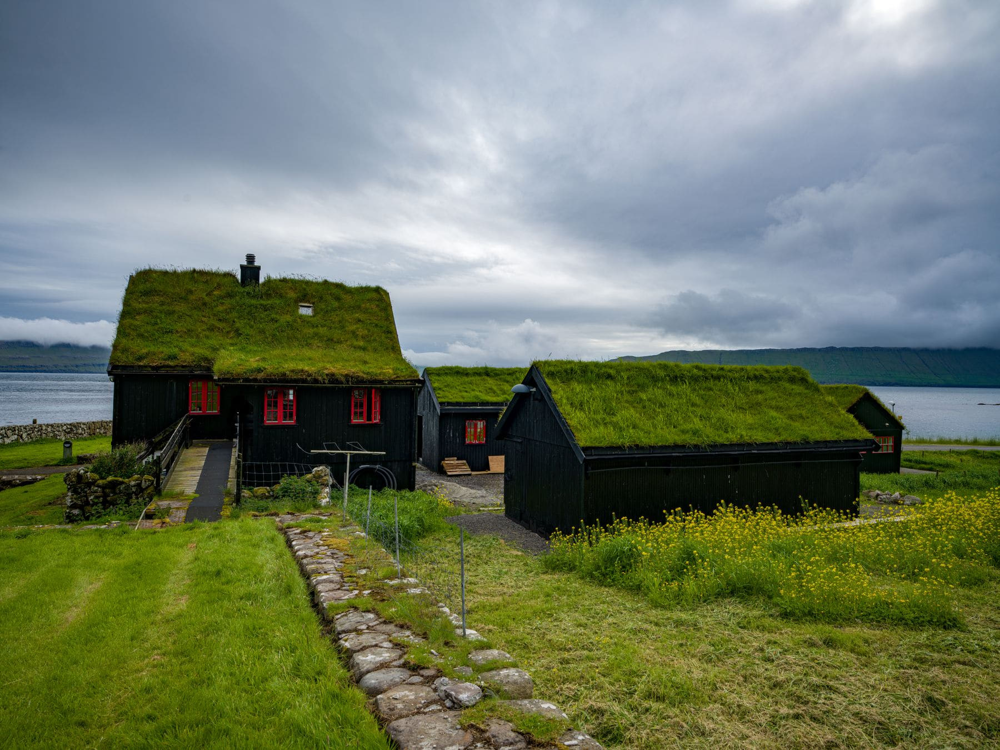

There is a whole class of building that has been made redundant by technology
and turned into somewhere to sleep. Lighthouses went automatic. Pilot stations
lost their pilots. Customs houses on small harbours stopped having anything to
inspect. What is left is a set of extremely solid buildings, in positions nobody
would be granted permission to build in today, available by the night.

They are rarely comfortable in the way a hotel is comfortable. They are almost
always in the right place.

_Not a lighthouse, but the same idea: built for the position, not the view. Photo: Rino Adamo._

## What to expect

- **Wind noise.** These buildings are on exposed ground on purpose, and at
  night you hear it.
- **Stairs.** Frequently spiral, frequently the only way to the bedroom, and
  never designed for a wheeled bag.
- **A drying room,** which tells you everything about how the building expects
  to be used.
- **No restaurant.** Shop before you go. The nearest one is a drive.

> The value of these places is entirely positional. You are paying to be at the
> end of a headland at four in the morning, and that is worth doing once.

## Booking

National trusts, coastguard charities and a handful of small operators run most
of them, and the listings are scattered rather than aggregated. Search by the
name of the lighthouse rather than the region. Book a minimum of two nights,
because one night is a drive there and a drive back.
