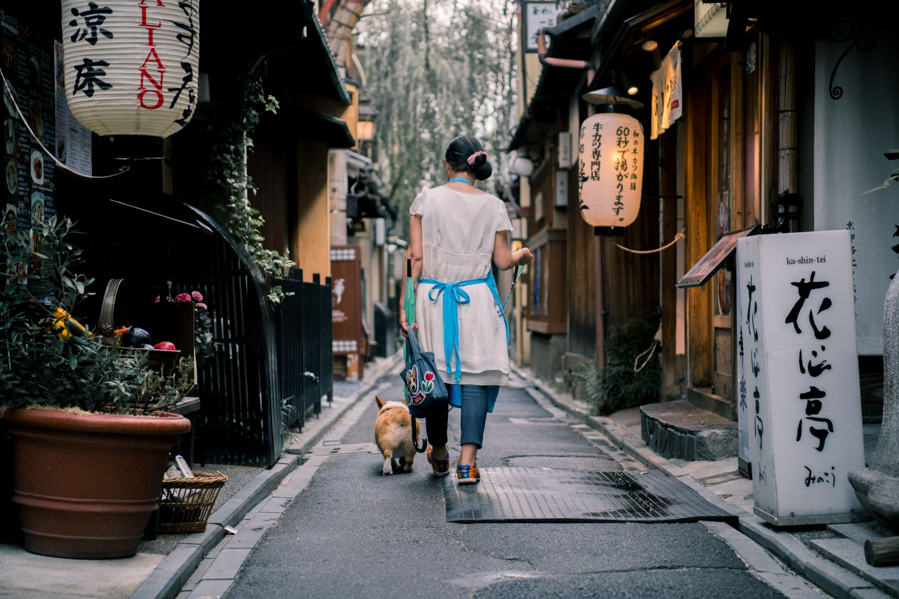

A ryokan is not accommodation with dinner attached. It is an evening with a
schedule, and the room is where the evening happens. Arrive at seven, as you
would at a hotel, and you will have missed the bath, the light, and the hour the
whole thing is arranged around.

Check in at three. That is not early; that is the start.

_Outside, briefly, between the first bath and dinner. Photo: Satoshi._

## The shape of it

- **15:00** — arrive, tea and a sweet in the room, change into the yukata.
- **15:30** — first bath, which is the quiet one. Most guests go after dinner.
- **17:00** — walk, if there is anywhere to walk to. There usually is.
- **18:00** — dinner, in the room or in a dining room, many courses, no menu.
- **20:00** — the futon appears while you are out of the room.
- **21:00** — second bath. Outdoors if there is one, and in winter especially.

> The bath is the reason, not the meal. People remember the meal because it is
> photographable, and remember how they slept because of the bath.

## Manners, briefly

Wash before getting in, not in. No swimwear, no towel in the water. Tattoos are
still a problem at some places and not at others, and the ones that mind say so
on the booking page. Ask about breakfast: it is enormous and at eight, and a
ryokan does not really do a lie-in.
