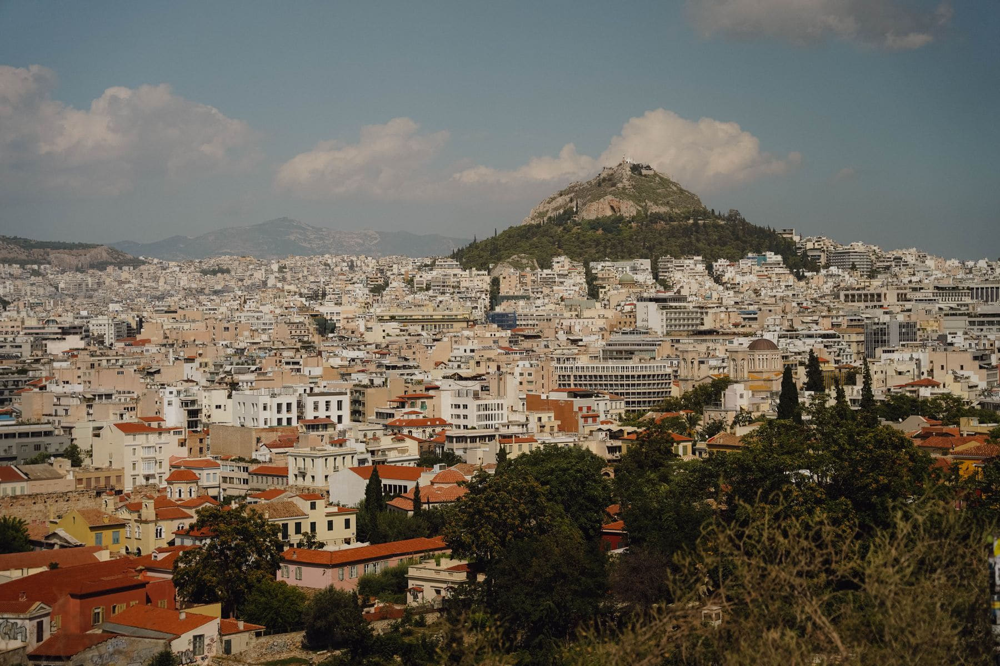

Everybody does the Acropolis first, and everybody should, and then a lot of
people are quietly disappointed by the rest of the week. The disappointment is a
sequencing error: you have started with the single most famous object in
European architecture and then gone looking for something to follow it.

Nothing follows it. Go sideways instead. Athens has perhaps a dozen small
museums and sites that would each be the main attraction in a smaller city, and
several of them are almost empty on a Tuesday.

_From Lycabettus, which is a funicular and ten minutes, and which nobody does. Photo: Maksim Romashkin._

## Four that are worth a morning each

- **The Kerameikos,** the ancient cemetery, with a small museum and about six
  other visitors.
- **The Byzantine and Christian Museum,** for the thousand years everybody
  skips between the temples and the modern city.
- **The Numismatic Museum,** in Schliemann's house, which is worth it for the
  house alone.
- **The Benaki,** whichever branch — the collections are split across four
  buildings and all four are good.

> The Acropolis Museum is the exception to the small-is-better rule. Go on the
> same ticket, on the same day, before the hill rather than after it.

## Timing the hill

First entry, or the last ninety minutes. In July the middle of the day on that
rock is genuinely dangerous and there is no shade anywhere on it. The evening
slot is better than the morning one, because the marble goes orange and the
crowd has thinned to people who also read this somewhere.
