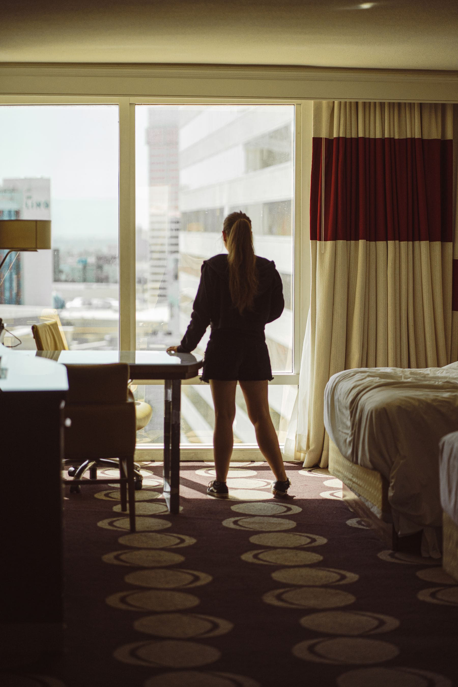

Every trip produces information. On day three you find out that the town you
allocated one night to is the best place you have been, and the city you booked
four nights in has about a day and a half in it. If the whole trip is booked,
that information is worthless.

So book the first half and leave the second. Not the whole thing — arriving
somewhere unfamiliar at ten at night with nothing reserved is a bad experience
with no upside. But the back three nights of a ten-night trip can stay open
almost anywhere outside a festival week.

_Booked at four in the afternoon for that night, which is how the good ones go cheap. Photo: Clement Proust._

## The rules that make it safe

- **Book arrival and departure nights** always. Those two are about logistics,
  not experience.
- **Check the calendar** for the region: a saint's day, a festival or a trade
  fair will empty a city of beds overnight.
- **Have a fallback,** an unbooked but identified place you would accept, so
  the decision is never made under pressure.
- **Do not do it in August** on a coast. Everywhere is full and the price of
  the one remaining room reflects it.

> The best night of most trips is somewhere you had not heard of on the day you
> left home. You cannot book that in advance, by definition.

## Where it pays most

Places where the good accommodation is small — Greek islands out of season,
rural Portugal, the Scottish west coast. Places with a dozen rooms in total
respond to a phone call in the afternoon in a way a hundred-room hotel never
will, and the phone call gets you a better price than the platform.
