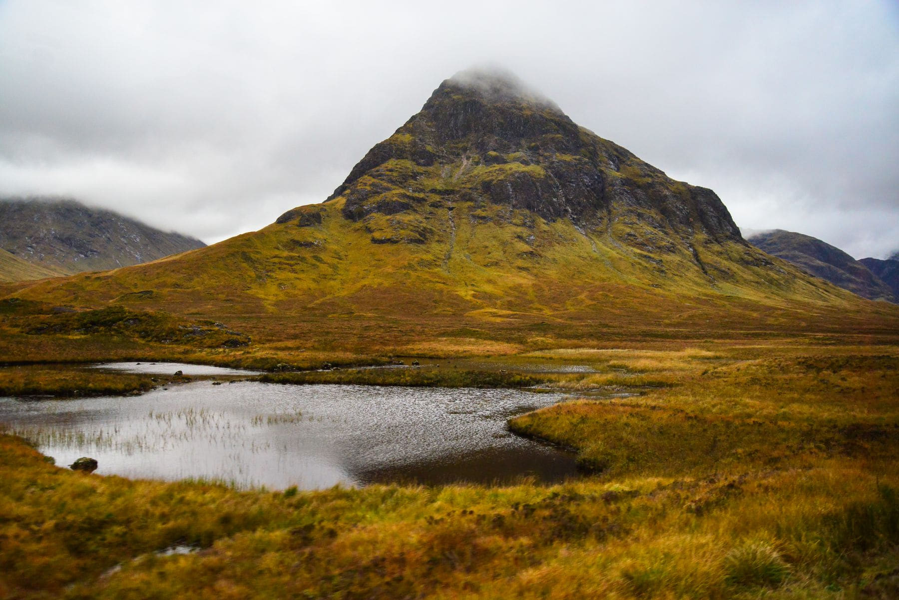

Cold water swimming has acquired an enormous amount of talk around it. Ignore
most of it. What is true is simple: a Scottish loch in June is about thirteen
degrees, thirteen degrees is survivable and unpleasant for roughly four minutes,
and four minutes is plenty.

The rule that matters is the one about getting out. Cold does its real damage
twenty minutes after you leave the water, when your core temperature is still
falling and you are standing in a car park feeling fine. Dress before you feel
cold, not when you do.

_The far end of the loch, which is where the shallow entry is. Photo: Nunzg._

## What to have in the car

- **A flask** of something hot, made before you swim, not after.
- **A hat.** Sounds trivial; is not.
- **Two towels** and a mat to stand on, because the ground is the problem.
- **Shoes you can swim in.** Loch beds are stones, and stones get slippery.

> Nobody has ever regretted a four-minute swim. Plenty of people have regretted
> a fifteen-minute one, and they regretted it in the car half an hour later.

## Where to go in

Look for a bay with a track to it, an obvious shallow shelf and no river mouth,
because a river mouth means cold plumes and current. If the map shows a hotel or
a ruined pier, there is usually a shelving entry near it: people have been
getting into that water for two hundred years.
