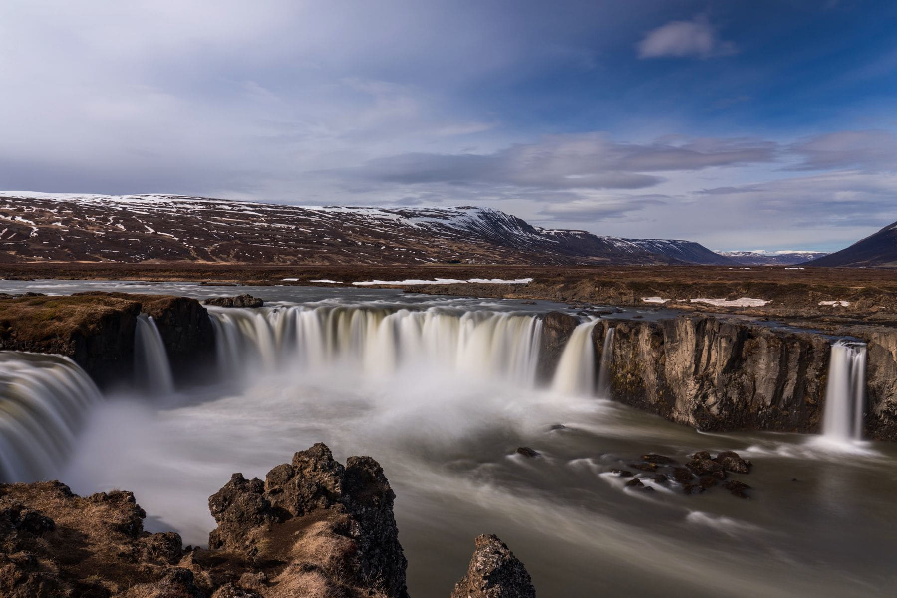

The south coast is a conveyor belt of waterfalls and it is very easy to see six
in a day and remember none of them. The trick is to stop at fewer and stay
longer, because they are all roughly the same from the car park and completely
different from anywhere else.

Take a coat you do not mind soaking. Not a shower-proof one — a properly
waterproof one, with a hood that stays up in wind, because at three of these you
will be standing inside the spray for twenty minutes.

_The second stop, where the path goes down to the pool rather than along the top. Photo: Suju._

## The four

- **Seljalandsfoss** — the one you can walk behind. Do it, get wet, and then
  walk the ten minutes north to the one in the cleft, which most people miss.
- **Skogafoss** — climb the steps. The falls are better from halfway up than
  from the base, and the path at the top follows the river for hours.
- **Kvernufoss** — a twenty-minute walk from a car park nobody uses.
- **Gljufrabui** — inside a slot in the rock, reached by wading. Bring the
  shoes for it or do not bother.

> The waterfall you remember is never the biggest one. It is the one you stood
> at for half an hour because the weather was doing something.

## The one to skip

Not because it is bad, but because by four in the afternoon you will have
reached your capacity for falling water, and standing in front of a fifth in
failing light while cold is nobody's idea of a good day. Drive on and have
dinner instead.
