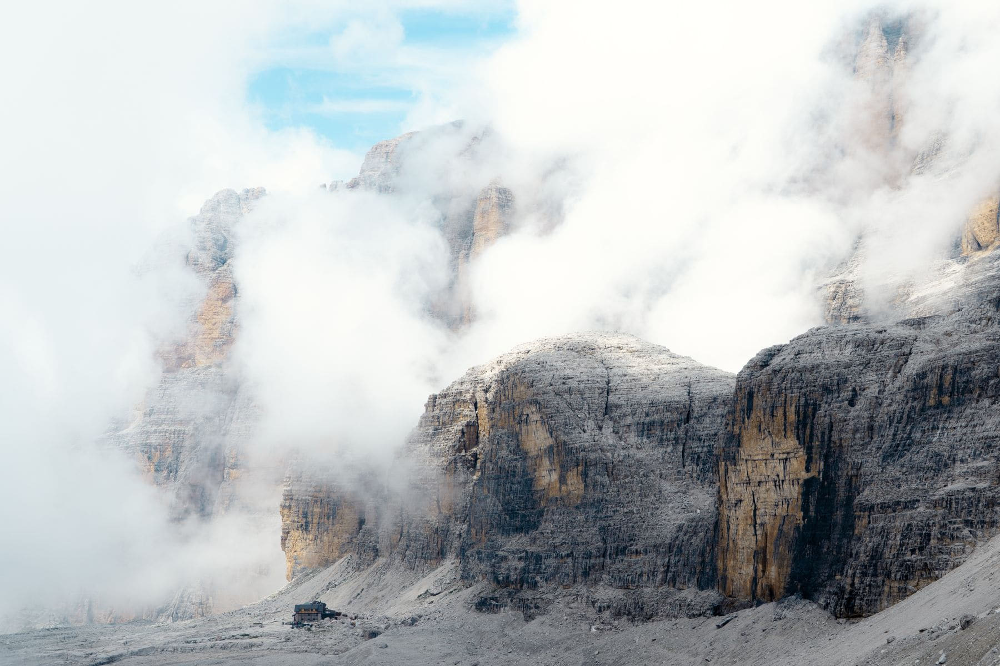

The thing that stops most people walking in the Alps is the camping. Carrying a
tent, a stove and four days of food over a pass is a different sport from
walking, and it is the sport people imagine when they say they could never do
it.

You do not have to. The Dolomites are covered in _rifugi_ — mountain huts with
bunks, showers and a kitchen — spaced roughly a day's walk apart. You carry a
sleeping bag liner, a change of clothes and a waterproof. That is it.

_The second morning, an hour after leaving the hut and about twenty minutes before the cloud lifted. Photo: Nicola Toscan._

## Three days that work

- **Day one:** up from the valley, four hours, mostly forest. Dull, and it gets
  the height done.
- **Day two:** the long one. Six to seven hours along the ridge, and the reason
  you came.
- **Day three:** down, three hours, knees complaining, bus at the bottom.

> A hut is not a hotel and it is not a bothy. It is a busy restaurant with beds
> above it, at two thousand metres, and the strangeness of that never quite wears
> off.

## Booking and manners

Book by email, weeks ahead, and confirm. Bring cash, because the card machine is
at the mercy of a radio link. Take your boots off at the door, take the top bunk
if you are the last to arrive, and be in bed by ten — everybody around you is
leaving at six.
