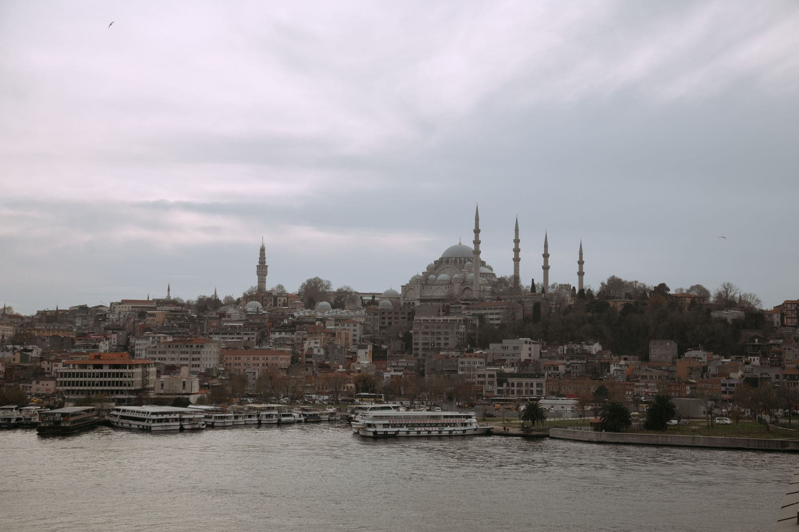

Istanbul is too big to walk and too interesting to drive through. What makes it
comprehensible is the water: the Bosphorus runs north to south with Europe on
one side and Asia on the other, the Golden Horn cuts into the European side, and
public ferries cross all of it constantly for the price of a bus ticket.

Do not book a cruise. Use the commuter boats, which go to the same places, take
the same route and are full of people going to work.

_The old city from the Asian side, which is where it actually looks like the pictures. Photo: Meruyert Gonullu._

## Three crossings

- **Eminönü to Kadıköy.** Twenty minutes, and the single best view of the
  historic peninsula there is. Go at dusk.
- **Karaköy to Üsküdar.** Shorter, less famous, and it lands you next to a
  neighbourhood most visitors never reach.
- **The long Bosphorus run to Anadolu Kavağı,** which takes most of a day, goes
  almost to the Black Sea, and costs less than a museum ticket.

> The tea on board is not incidental. There is a man with a tray, the glass
> costs almost nothing, and drinking it while the old city slides past is the
> whole experience in one object.

## The other shore

Spend a full day on the Asian side. Kadıköy has the market, the bars and about a
tenth of the visitors, and the walk south along the coast from Moda is the most
ordinary and most pleasant thing in the city.
