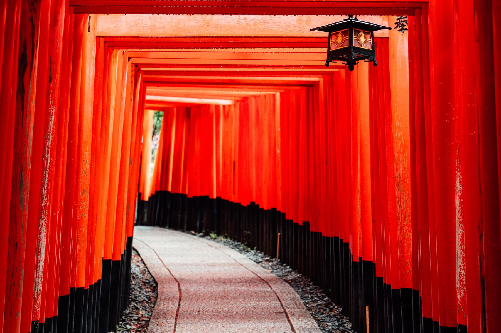

There is a version of Kyoto with four hundred people in it and a version with
nine, and they are separated by ninety minutes of sleep. That is the whole
article. Everything below is detail.

Temple grounds open long before the halls do, and several of the famous walks
are streets rather than sites and so never close at all. Between about five and
seven in the morning you can have the lot: Gion with the shutters down, the
Philosopher's Path with nobody on it, the lower gates at Fushimi Inari in
silence.

_The lower gates at Fushimi Inari, only ever this empty at dawn. Photo: G N._

## A first morning that works

- **05:30** — walk to Fushimi Inari. Go up for forty minutes, not to the top.
- **07:15** — two stops north, breakfast near Tofuku-ji.
- **08:30** — Kiyomizu-dera as it opens, then down through the Ninenzaka lanes
  while the shops are still putting their boards out.
- **10:30** — stop. Sleep. Come back out at four.

> Kyoto does not reward stamina. It rewards two short days stitched into one,
> with a gap in the middle where you are not looking at anything.

## What to drop

The bamboo grove at Arashiyama is a hundred metres long, it is photographed from
the one angle that hides a fence, and by nine it holds a crowd four deep. If you
are going anyway, be there at seven. When you have had your ninety seconds, walk
on into the park behind it, which is enormous, empty and much better.
