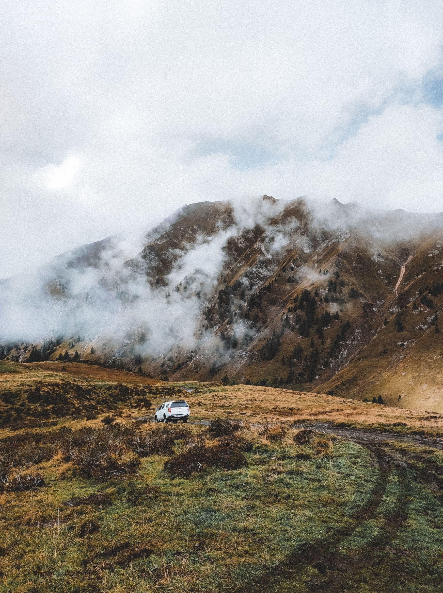

Driving in the Alps has been quietly ruined by efficiency. The motorway goes
through the mountain now, the pass road above it is empty, and most people never
find out the pass road is there because the satnav has no reason to mention it.

Turn the routing off and pick the passes deliberately. A good one gives you
twenty minutes of hairpins, a cafe at the top that has been there ninety years,
and a descent into a completely different valley with a different language at
the bottom of it.

_Third pass of the second day. The cloud sat at exactly this height until four. Photo: Alexey K._

## The direction rule

Drive passes so the drop is on the passenger side. It sounds like superstition
and it is not: on a road with no barrier and a two-metre lane, the difference
between hugging a rock wall and hugging four hundred metres of air is the
difference between a pleasure and an ordeal.

- **Start early.** Coaches and cyclists both own these roads by ten.
- **Check opening dates.** Many are shut until late May and some until June.
- **One tank is enough** for the loop, but not for the loop plus a detour, and
  the top of a pass is the worst place to discover that.

> Nobody remembers a tunnel. Everybody remembers the cafe at the top of the
> second pass, and the fact that it only took cash.

## Two days, not one

You can do this in a long day and you will hate the second half. Break it at the
bottom of a valley, sleep, and do the remaining four passes in the morning when
the light is across the road rather than down it.
