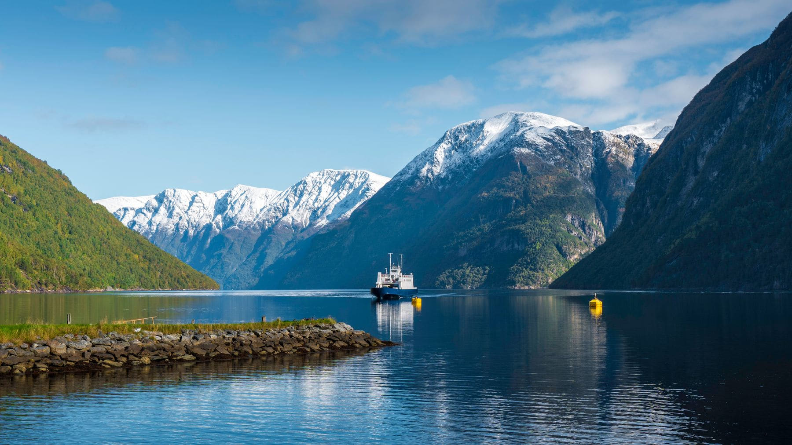

Everybody hires a car in Bergen. It is the obvious move and it is usually the
wrong one, because the roads along the big fjords spend most of their length in
tunnels, and a tunnel is a tunnel whatever is above it.

The boats are still there. Not the tourist cruises with the commentary — the
ordinary public ferries that carry post and bicycles and people going to work,
running on a timetable that has barely changed in decades.

_Most of the fjord has no road at all on this side. Photo: Raulling._

## The route that works

Take the express boat out of Bergen up the Sognefjord, get off at Balestrand,
stay two nights, and come back on the slow local ferry with every stop on it.
The express does the distance; the local does the fjord.

- **Book the express;** turn up for the local.
- **Sit outside** for the first hour out of Bergen, then go in. It gets cold
  well before it looks cold.
- **Take the 07:30** if there is one. Morning light runs down the west wall and
  the water has not been touched yet.

> A fjord is a corridor, and you are meant to be in the middle of it. Every
> photograph you have seen of one was taken from a boat.

## The unglamorous bit

The ferries are not cheap and they are not fast, and in October half of them
stop. Check the winter timetable before you build a week around one, because
"four sailings a day" becomes "one, on Tuesdays" with very little warning.
