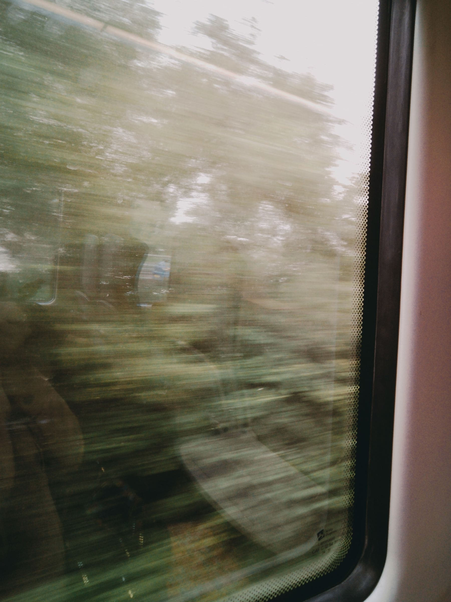

The one-lens argument is usually presented as an aesthetic discipline, which
makes it sound like self-denial. It is more boring and more useful than that:
every time you change a lens you stop looking, and the thing you were looking at
goes away.

A street has a duration. The man with the ladder is on the corner for about
nine seconds. If you spend six of them deciding between 35mm and 85mm, you have
a photograph of a corner.

_Taken at 1/15th because there was no second option to reach for. Photo: Fotios Photos._

## What to take

- **One body, one lens, in the 28mm to 40mm range.** Wide enough for a street,
  long enough for a face at three metres.
- **Two batteries.** Cold halves them and you will be out all day.
- **A cloth.** Salt, dust, rain, fingerprints — in that order of frequency.
- **No bag.** A bag means the camera is in the bag.

> The best travel photographs are almost never of the thing you went to see.
> They are of the twenty minutes before or after it, and you have to be holding
> the camera during those.

## The honest limitation

You will miss the wildlife, the stage-lit interior and the compressed mountain
shot. That is three photographs a trip. Weigh them against the two hundred you
will take because the camera was in your hand rather than in a bag on your back,
and the arithmetic is not close.
