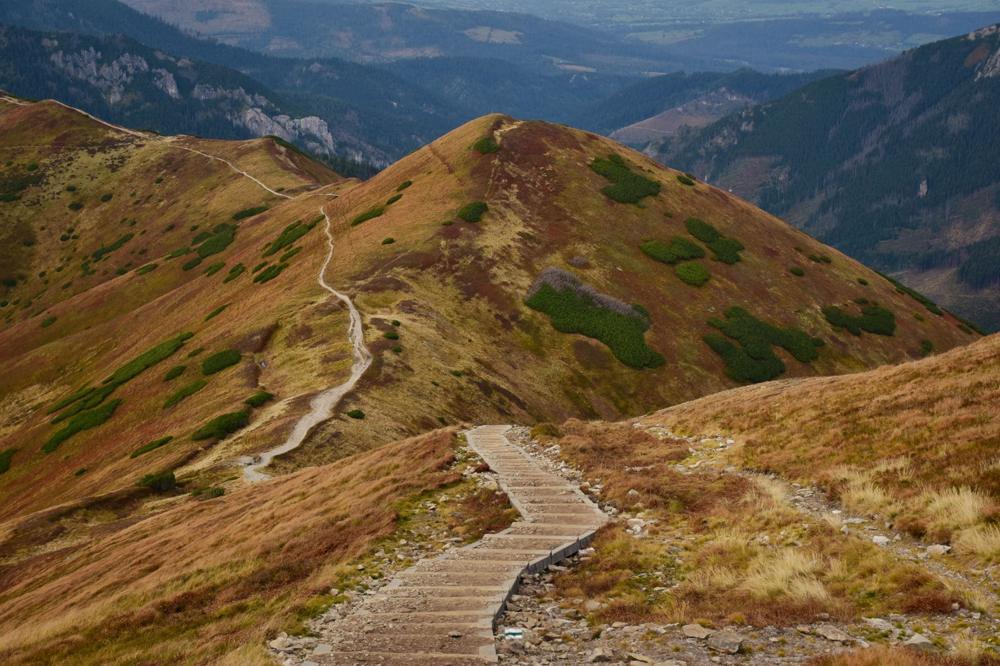

The Camino has an image problem: it looks like a commitment. Five weeks, a
rucksack, a crisis of some sort in the middle. Plenty of people do that and
speak well of it, but it is not the only door in.

A stage is twenty to twenty-five kilometres between two towns that both have
beds, a bar and a bus. You can walk one on a Saturday. You will still get the
waymarking, the strangers who become companions for an hour, the last four
kilometres that hurt, and the beer at the end, which is the actual point.

_Not the Camino itself, but exactly what the last hour of a stage feels like. Photo: Aleksandra S._

## Picking one

- **Start where the bus goes.** The romance of a remote start wears off at the
  station on the way home.
- **Twenty kilometres, not thirty,** for a first attempt, and check the ascent
  rather than the distance. Six hundred metres of climb turns twenty into
  thirty.
- **Book the bed.** Walking without one is part of the full experience and
  completely unnecessary for a single day.

> Nobody who has walked one stage has ever said they wished they had walked
> further. Several have said they wished they had started earlier.

## What to carry

Two litres of water, a jacket you can walk in, and less than you think. The one
thing worth the weight is a spare pair of socks, changed at the halfway point,
which sounds like fussing and is the single best thing you can do for your feet.
