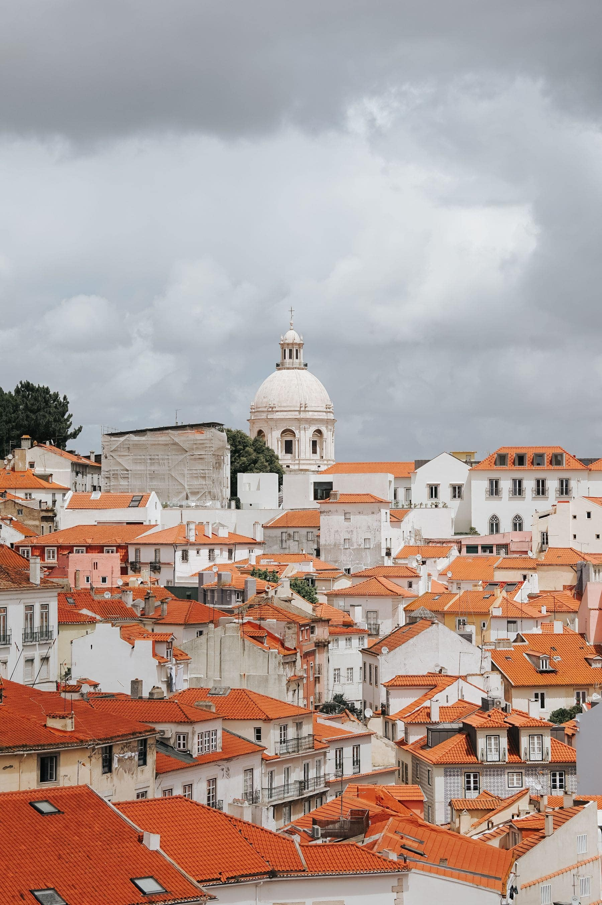

Porto is two towns that agreed to share a river. Everything people come for is
on the north bank; everything they photograph the north bank _from_ is on the
south. You cannot do the city properly without crossing at least twice, and the
crossings are the best part of it.

Start at the top. Walk out onto the upper deck of the Luis I bridge, where the
metro runs and where the drop is genuinely alarming, and keep going to the Serra
do Pilar terrace. That is the postcard, and it is worth ten minutes before the
coaches arrive.

_Looking back over the old town from the south bank. Photo: Tobias Reinert._

## Down, then back

The descent into Vila Nova de Gaia takes twenty minutes and the cellars at the
bottom open at ten. Book one. They are all much the same, and which one matters
far less than the fact that you sat down for an hour in the middle of a day
made entirely of hills.

- **Cross high, return low.** The upper deck for the view, the lower deck for
  the shade and the river noise.
- **Ribeira is for the evening,** not for lunch. At noon it is a wall of menus
  in four languages.
- **The cathedral is free;** the cloister is not, and the cloister is the part
  worth paying for.

> Porto rewards being slightly above it. Ten metres of height turns the whole
> town from a jumble into a plan.

## The bit people skip

Walk east instead of west. Past the Infante bridge the riverfront empties out
inside four hundred metres, and a path follows the water for another two
kilometres with nothing on it but joggers and one very good cafe. It is the only
stretch of Porto where the river is allowed to be just a river.
