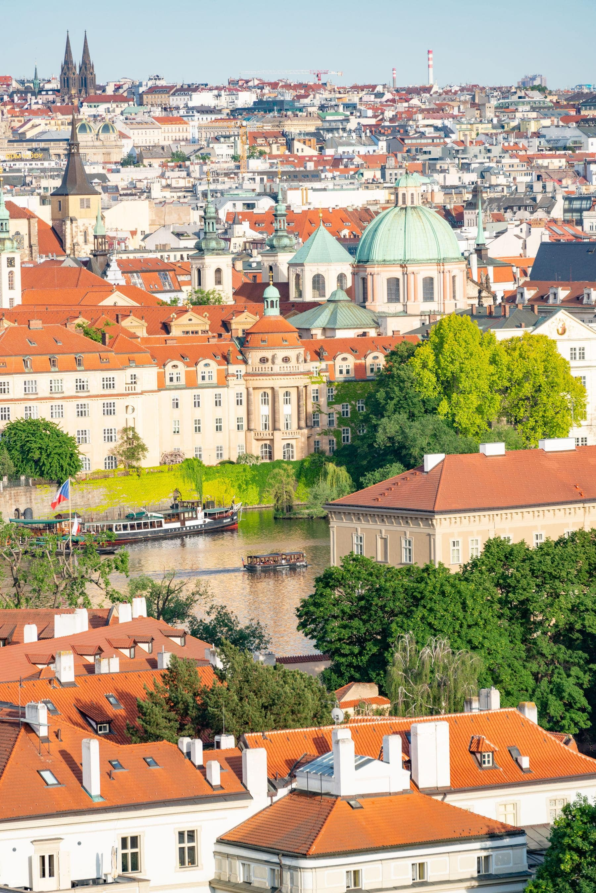

Prague is the right size for this experiment. The old town is about two
kilometres across, the castle is a hill on one side of it, and you cannot get
meaningfully lost because the river is always downhill. So we booked a flat and
nothing else, and spent four days finding out what a city offers when you are
not asking it for anything specific.

Mostly it offers mornings. The bridge that is a crush at eleven has about
fifteen people on it at half past six, and half of them are photographers who
will not look at you.

_From the castle side, which is where the whole town lines up. Photo: Diego F. Parra._

## Four days, no plan

- **Day one:** cross the river four times. That is the only instruction.
- **Day two:** pick a tram, ride it to the end, walk back towards the middle.
- **Day three:** one big thing, booked that morning. One.
- **Day four:** go back to whichever of the first three days you liked.

> Cities are not lists. The list is a way of getting somebody through a weekend
> without them noticing they never actually looked at anything.

## Where it falls down

It falls down on anything that needs booking. We did not see the inside of the
Strahov library, because the slots go days ahead, and there is no version of
unplanned travel that beats a timed ticket. Book the one or two things that
genuinely require it, then leave the rest alone.
