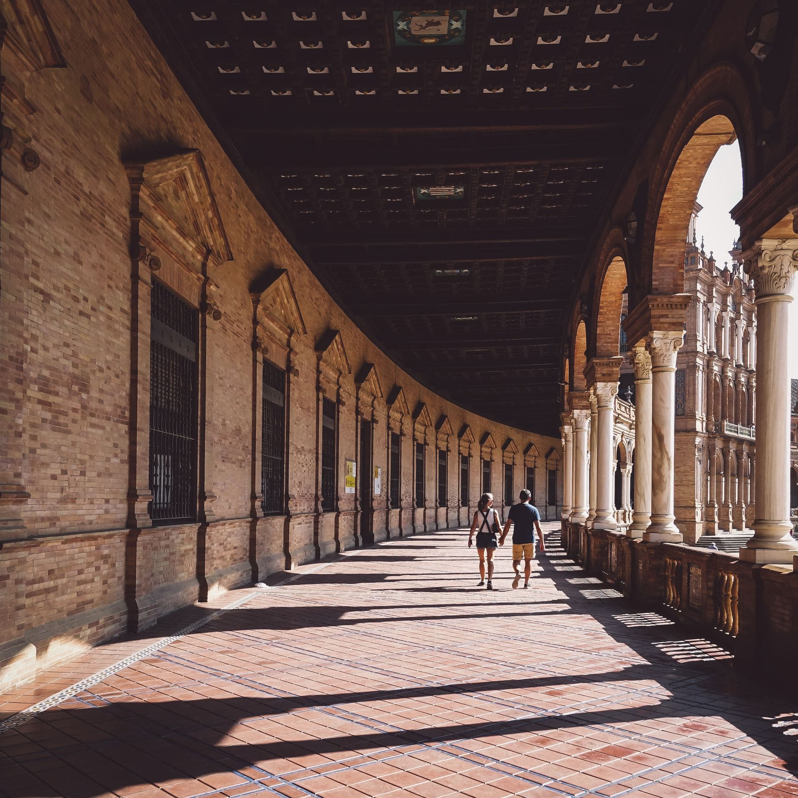

Nobody plans a July trip to Seville. People end up there in July, discover it is
forty degrees at four in the afternoon, and conclude the city is unvisitable for
a third of the year. It is not. It is a city with a very old and very good
answer to heat, and the answer is shade.

The old town was laid out so that you can cross most of it without leaving it.
Streets run narrow and north to south on purpose. From June the city strings
canvas awnings over the busiest of them, and under one at two in the afternoon
it is a genuine ten degrees cooler.

_The colonnade at the edge of the old town, walkable at any hour. Photo: Ricky Esquivel._

## The shape of a hot day

- **07:00 to 11:00** — the Alcazar, the cathedral, anything with a queue.
- **11:00 to 14:00** — the shaded streets: Sierpes, Cuna, the lanes behind them.
- **14:00 to 18:00** — indoors, and genuinely indoors. This is not a failure of
  nerve, it is what everybody who lives here does.
- **18:00 to midnight** — the river, the bridges, the whole city outside again.

> The mistake is treating the afternoon as time lost. Four hours out of the sun
> is what buys you the six hours after it, and the six hours after it are the
> reason to have come.

## Courtyards

Ask about patios. Dozens are private, some are semi-public, and a handful open
properly in the first two weeks of May for the patio festival. Even outside it,
a surprising number of doors stand open onto a tiled square of shade and a
fountain, and nobody minds you looking as long as you stay on the step.
