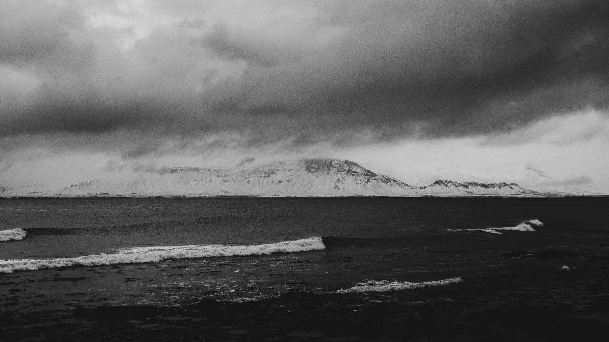

The standard argument for travelling in April or October is that it is cheaper
and emptier. Both are true and both are slightly beside the point, because they
frame the off-season as a compromise — the same trip, discounted, with worse
weather.

For a large number of places it is not the same trip. It is a better one.
Coastlines, moorland, mountains and northern cities are all designed by their
weather, and in the months when the weather is doing nothing they are versions
of themselves with the interesting part removed.

_February on an Atlantic coast, which is the only month it makes sense. Photo: WorldIsNotOurHome._

## Places that improve

- **Anywhere with a sea wall.** A harbour in a gale is the thing the harbour was
  built for.
- **Northern cities.** Copenhagen, Edinburgh and Hamburg are built around being
  indoors, and in August that architecture has nothing to do.
- **Moorland and fell.** Needs low cloud and low light to look like anything.
- **Big museums,** which stop being a queueing exercise.

> A wet week somewhere built for wet weather beats a fine week somewhere that
> only works in the sun and is full of everybody else who booked it.

## Places that do not

Be honest about the exceptions. Anything whose point is swimming, anything above
two thousand metres between October and June, and anywhere that closes — Greek
islands in January are not atmospheric, they are shut. Check the ferry timetable
before booking the romance.
