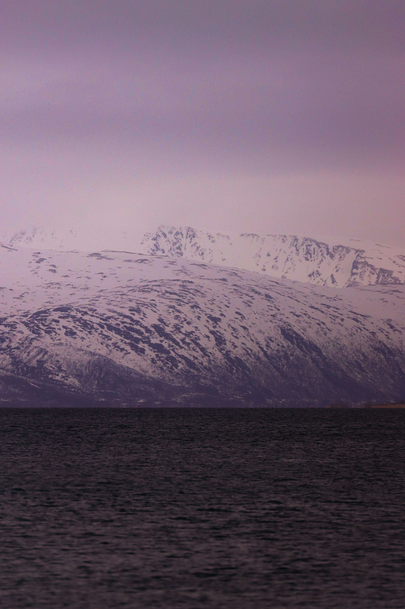

There is a photograph of the Atlantic Road that everybody has seen: a bridge
apparently curving into nothing, with a wave breaking over the parapet. It is
not a trick shot and it is not summer. It is late autumn, which is when the
place is actually worth eight hours in a car.

In July it is a pleasant coastal drive with a queue at the viewpoint. In October
the wind comes in off open ocean with nothing between here and Iceland, the road
gets closed perhaps twice a season, and standing on the causeway is a genuine
physical event.

_Inland from the coast road, an hour before the weather arrived properly. Photo: Efrem Efre._

## Going in the bad half of the year

- **Check the road status,** not just the forecast. Closures are posted and
  they are short.
- **Book somewhere on the road,** not in Molde. The point is to be there at
  dusk and at dawn, not to drive out and back.
- **Take a tripod you trust.** Everything worth photographing here happens in
  bad light and high wind.

> Fine weather makes this a nice drive. Weather makes it the reason you came,
> and the two are barely the same road.

## The rest of the loop

Do not treat it as a destination on its own — it is twenty minutes end to end.
String it with the Trollstigen road while that is open, the ferry across to
Averøy, and one night somewhere with a window facing west. That is a proper two
days.
