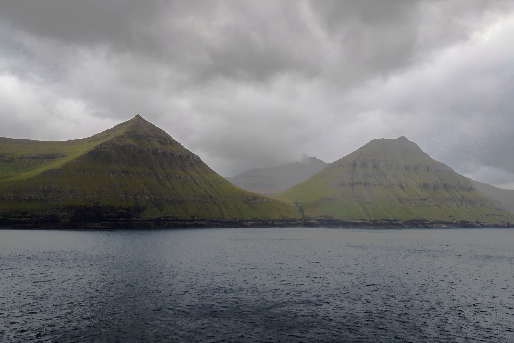

There is no point writing a Faroes itinerary. You can write a list of eleven
things and an order to attempt them in, and then the fog comes down on Vagar and
the order is decided for you. Everyone who goes learns this in about a day and a
half.

What works instead is a list with a weather condition attached to each item.
Clear and still: the coastal walks. Clear and windy: the drives, and the ferry
if it is running. Low cloud: the villages, the museum in Torshavn, the long
tunnels, the cafe.

_Low cloud is not a bad day here. It is most days, and the place is built for it. Photo: Veronika Benz._

## Things that need clear weather

- **Sorvagsvatn,** the lake that appears to sit above the ocean. Worthless in
  fog, extraordinary otherwise.
- **The Kallur lighthouse walk** on Kalsoy, which needs the ferry as well as
  the visibility.
- **Anything on Mykines.** The boat cancels more often than it sails.

> Locals do not talk about good weather. They talk about a good window, which is
> about ninety minutes long and arrives without warning at half past four.

## The practical bit

Hire a car with the tunnel toll included, book accommodation for the whole week
in one base rather than moving, and understand that several of the best walks
cross private land and charge for it. Pay it. It is what keeps the paths open.
