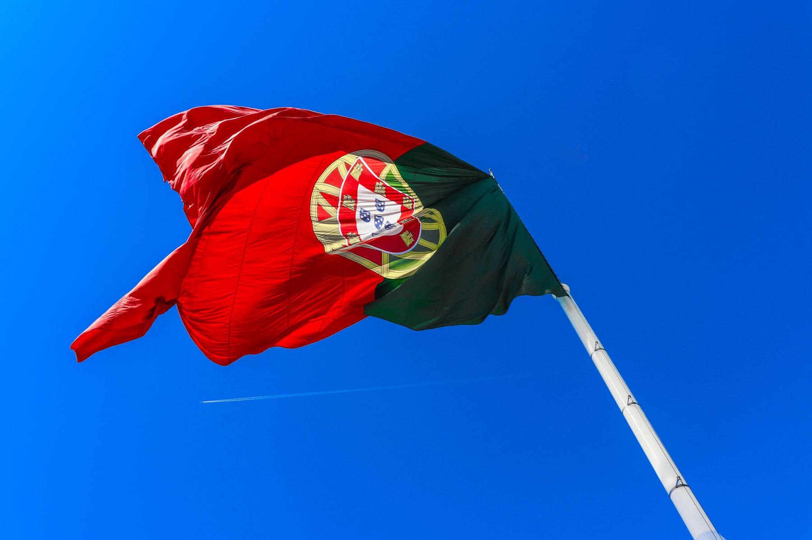

The N2 is Portugal's Route 66, in the sense that it is a long old road that was
made redundant by a motorway and then rediscovered by people who wanted the long
version back. It runs from Chaves in the far north to Faro on the south coast,
and it crosses eleven districts and four mountain ranges on the way.

What makes it good is not scenery, exactly. It is that the road still goes
_through_ things. Every twenty minutes there is a village with a bar, a church
and four men outside the bar, and the motorway thirty kilometres west has taken
all the traffic and left them alone.

_Halfway, near Sertã, where they have made a small industry out of the road. Photo: Russell Butcher._

## Seven days

- **Days one and two:** Chaves down through the Douro. The hardest driving and
  the best views of the trip, in that order.
- **Day three:** the Serra da Estrela crossing. Cold at the top in any month.
- **Days four and five:** the middle, which is where the road is at its most
  itself: cork oaks, empty tarmac, nobody.
- **Days six and seven:** the Alentejo and the drop to the coast.

> The N2 is not a scenic route. It is an ordinary road through a country that
> stopped using it, which turns out to be a much rarer thing.

## Practicalities

Get the passport stamped. There is a booklet, shops along the route stamp it,
and it is exactly the sort of gimmick that turns out to be the best part.
Otherwise: fuel in towns rather than villages, and do not trust an eight o'clock
dinner outside the two ends.
