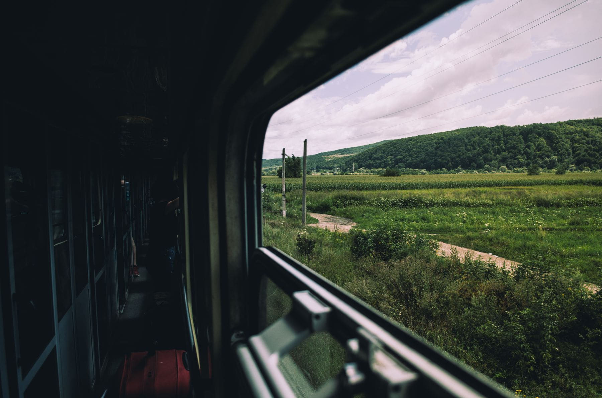

The argument for the night train is usually made badly. People talk about
romance, and romance is not a thing you can put in a spreadsheet next to a
seventy-euro fare. Here is the version that survives arithmetic.

A sleeper from Vienna leaves at about nine and puts you in Venice a little after
eight. That is thirteen hours of a journey you were going to spend somewhere
anyway, and it replaces a night of accommodation. Against a flight you are
trading two hours in the air for zero hours at two airports, zero transfers, and
one fewer hotel night.

_Somewhere after Villach, which is where the good bit starts. Photo: Tudose George._

## What it actually costs

- **Couchette, six berth:** the cheap option, and fine if you are on your own
  and sleep through anything.
- **Couchette, four berth:** the sweet spot. Enough room to sit up, cheap enough
  to still beat a hotel.
- **Sleeper with a basin:** roughly double, and worth it exactly once, on the
  night before something that matters.

> The sleeper is not a way to see a country. It is a way to be somewhere else in
> the morning without having spent a day getting there.

## When not to

Do not take it if the train arrives before seven, because nothing is open and
you will spend two hours in a station with a bag. Do not take it two nights
running. And do not take it expecting silence: a sleeper is a corridor of doors,
and at four in the morning somebody always needs the one at the end.
