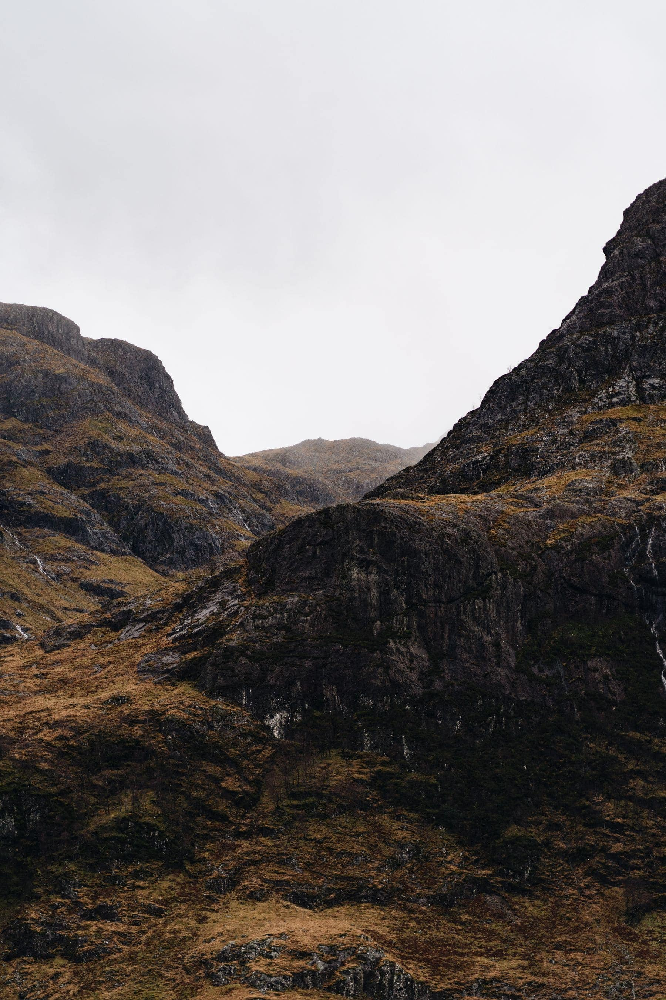

The North Coast route has been a victim of its own signage. It was invented as a
marketing idea, it worked far too well, and for a few summers it turned some of
the emptiest roads in Britain into a queue of camper vans doing it in four days
because a blog said four days was enough.

Four days is not enough. Four days is 200 kilometres a day on roads where the
average speed is closer to forty, which means the whole trip is driving and the
stops are photographs taken through a windscreen.

_The bit between Durness and Tongue, which is worth an entire day on its own. Photo: Ekrulila._

## How to use nine days

- **Three nights in the northwest.** Assynt and Sutherland are the reason the
  road exists.
- **Two nights on the north coast proper,** which is beaches, and they are
  extraordinary and freezing.
- **Two nights on the east,** which is the quiet half and much underrated.
- **Two spare.** Something will be shut, or the weather will hand you one
  perfect day that deserves to be used somewhere else.

> Passing places are for passing and for letting people by. They are not
> viewpoints, and the single thing that makes locals despair is a car parked in
> one with nobody in it.

## Fuel and food

Both are further apart than you expect. North of Ullapool, fill up whenever you
are under half a tank, and assume the kitchen stops at eight. This is not a
hardship; it is simply a different set of rules from the one the route is
usually planned under.
