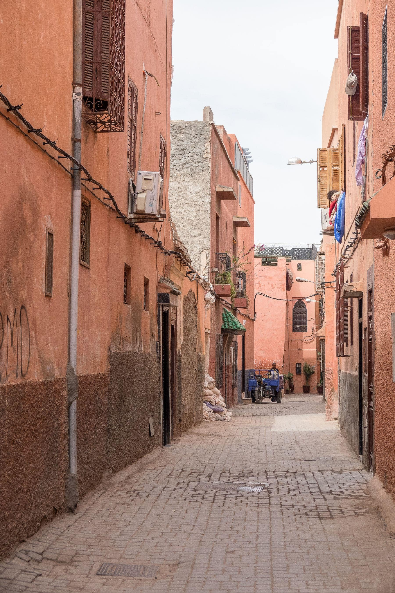

A riad is a house built inward. Every room faces a courtyard, the outside walls
have almost no windows, and the whole thing is arranged so that the hottest part
of the afternoon happens somewhere you are not. Once you have slept in one, a
hotel room with a view of a street feels like an odd thing to have wanted.

The trouble is that "riad" has become a marketing word, and half the places
using it are ordinary guesthouses with a plunge pool in an atrium.

_The last thirty metres, which no taxi is going to drive. Photo: Mike Van Schoonderwalt._

## Telling them apart

- **The entrance is a bend.** A real riad has a dog-leg between the street door
  and the courtyard, so that nobody outside can see in.
- **The courtyard is the middle,** not a feature at one end.
- **Rooms are different sizes,** because it was a family house and not a plan.
- **The roof terrace exists** and is used, which is where you will end up every
  evening.

> Ask how many rooms. Under eight and you are in a house. Over fifteen and you
> are in a hotel that has bought three houses and knocked them together.

## The alley problem

The address will be unfindable and this is normal. Every riad will meet you at a
recognisable corner if you tell them which one you are arriving at, and every
one of them expects to. Arrange it in advance; do not stand in the medina at
eleven at night with a suitcase and a screenshot.
