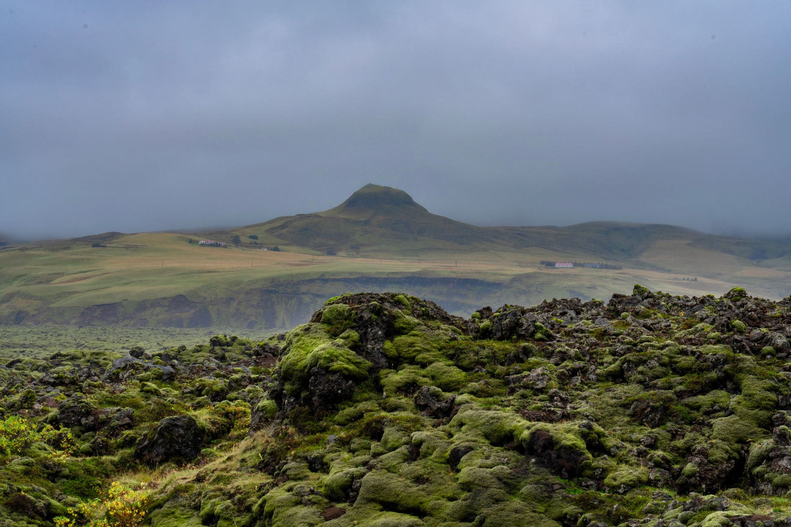

Iceland's ring road is 1,332 kilometres and almost everybody drives it in the
same direction: south first, because that is where the famous stops are and
because the rental desk hands you a map with the route drawn that way.

Go the other way. The south coast is the busiest third of the road and the part
that most rewards an empty car park, and if you arrive there on day eight rather
than day two you get it in the second half of the afternoon, in autumn light,
after every coach has turned for home.

_Day three, east side, and the last car we saw for forty minutes. Photo: Suju._

## Seven days, the other way round

- **Days one and two:** north from Keflavik, Borgarnes, the long empty run to
  Akureyri.
- **Day three:** Myvatn. The one place worth two nights.
- **Days four and five:** the east fjords, which are the quietest and the least
  photographed part of the whole loop.
- **Days six and seven:** the glacier lagoon, then west along the south coast
  into the evening.

> The direction is not a detail. It decides whether the sun is in your
> windscreen or over your shoulder for six hours a day, for a week.

## What will go wrong

Wind. Not rain — wind, which closes roads, takes car doors off their hinges and
is the single most common cause of a claim on an Icelandic hire car. Check the
road service site every morning, take the gravel protection, and never open a
door without holding it.
