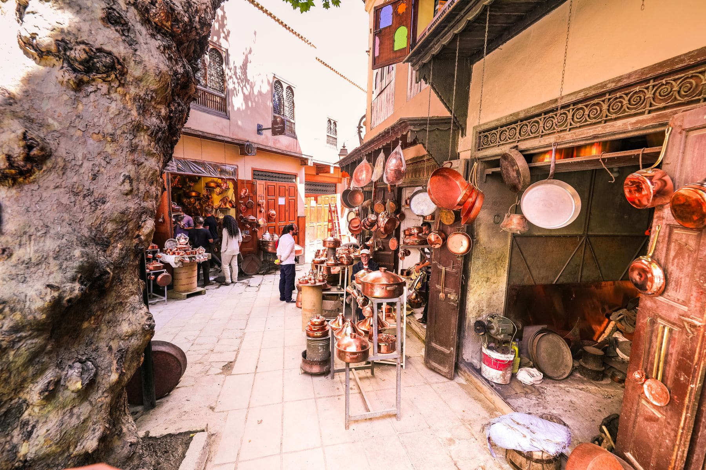

Two things are true about the souks at once. They are a working market where
several thousand people earn a living, and they are a place where a visitor with
an open map and a worried expression is a commercial opportunity. Neither is
sinister. Both are worth understanding before you walk in.

The medina is not a maze. It is a set of long spines with short ribs off them,
and if you learn four fixed points you can always get back to one.

_The metalworkers' section, which is loud and the best part. Photo: Naimbic._

## The four points

- **Jemaa el-Fnaa,** the big square, south end of everything.
- **The Koutoubia minaret,** visible from a great deal of the medina.
- **Souk Semmarine,** the wide main spine going north out of the square.
- **The Ben Youssef Madrasa,** the north end. If you reach it you have gone far
  enough.

> Being lost in the souks costs you twenty minutes and a wrong turn. That is the
> entire risk, and it is also more or less the point.

## On prices

Ask, be told a number, and either buy it or do not. The long ritual of haggling
is real in some trades and performance in others, and the useful discipline is
to decide what the object is worth to you before anybody says a figure. Then the
negotiation has one move in it and you are not playing a game you will lose.
