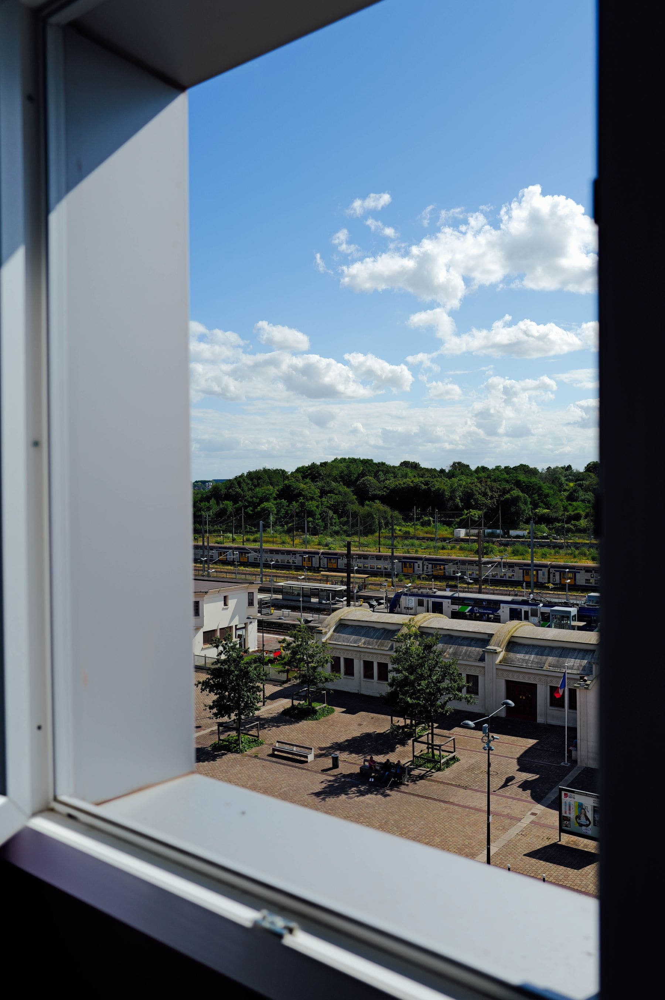

The rail argument is usually made by people who love trains, which makes it easy
to dismiss. So here is the version with a stopwatch on it.

A flight advertised as ninety minutes is, door to door: forty minutes to the
airport, two hours before departure, ninety in the air, thirty to get out, and
forty into the city at the other end. That is five hours and twenty minutes. A
train advertised as four hours is fifteen minutes to the station, ten minutes
before departure, four hours, and ten minutes out. Four hours thirty-five.

_The other advantage: stations are where you already are. Photo: Adrien Olichon._

## The crossover

- **Under four hours of rail time:** the train wins outright, every time.
- **Four to six hours:** the train usually wins on door-to-door and always wins
  on comfort. Price decides it.
- **Six to nine hours:** genuinely close. A sleeper changes the answer; a
  daytime train usually does not.
- **Over nine hours:** fly, unless the journey is the point. Sometimes it is.

> The hour that decides this is the two hours before a flight, and no amount of
> fast-track changes it, because you still have to be there to use it.

## Where the romantics are wrong

Long daytime trains across a continent are tiring in a way people underplay. So
is a connection with twenty minutes on it and a delayed inbound. And rail fares
bought late are frequently worse than flights bought late, because airlines
overbook and railways do not.
