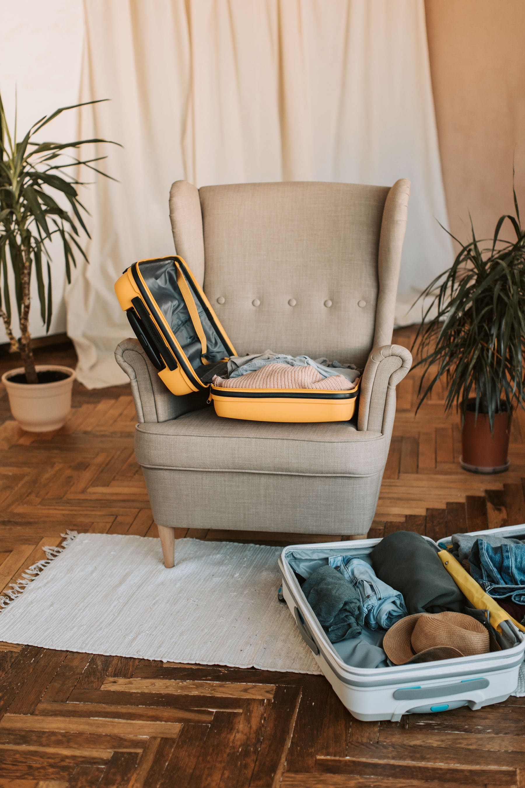

One-bag travel has a tiresome culture around it and an extremely practical core.
The tiresome part is the competition about weight. The practical part is that a
bag you can carry up three flights, put in an overhead locker and walk forty
minutes with removes about half the friction from a trip.

The number that matters is not litres. It is how many times a day you have to
decide what to do with it.

_The cube system, which is the only organisational thing that has survived. Photo: Vlada Karpovich._

## The four items doing the work

- **A merino layer.** Worn four days running without becoming a problem, which
  is the entire mechanism by which two weeks fits in one bag.
- **A shell that packs to nothing** and is honestly waterproof. Not
  shower-proof.
- **One pair of shoes you can walk 20km in and wear to dinner.** This is the
  hardest item on the list and it is worth spending money on.
- **A flat washbag that hangs,** because the failure mode of small bathrooms is
  surface area.

> Everything else is replaceable at the destination, usually within an hour,
> usually for less than the cost of checking a bag.

## What always gets over-packed

Trousers, and books. Two pairs of trousers is enough for fourteen days and
nobody has ever finished three books on a trip that involved actually going
anywhere. Take one, and accept that you will buy another in an airport against
your better judgement.
