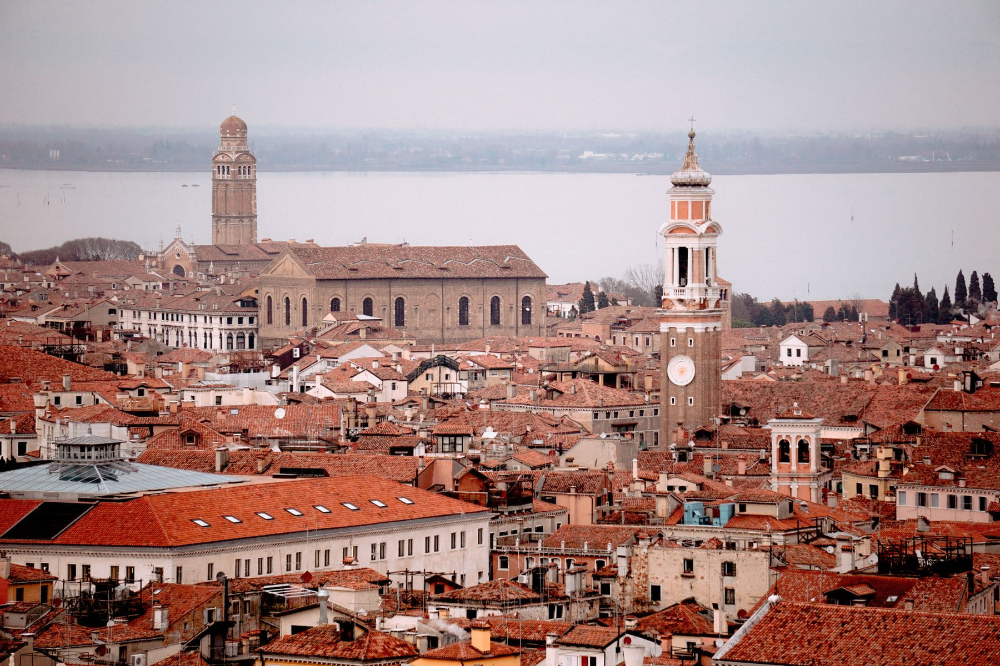

The statistic that explains Venice is this: the large majority of the people in
it on any given day arrived that morning and will leave that evening. They come
off cruise ships and coaches and the train from Mestre, they walk one route
between the station and the square, and by seven they are gone.

Sleep in the city and you get the other sixteen hours. They are not busy. In
Cannaregio at eight in the evening you will walk for ten minutes and pass four
people, three of whom live there.

_From the north side, looking across to the lagoon, at the hour nothing is open. Photo: Sandra Filipe._

## The two good hours

- **Early.** Between six and eight the deliveries happen — everything in Venice
  arrives by boat, and watching a supermarket restocked from a barge is a
  better introduction to the city than any museum.
- **Late.** After nine the day-trip routes empty completely and the only
  crowded places are the ones with tables outside.

> A city that is impossible at noon and empty at nine is not overrun. It is
> badly timetabled, and the timetable is the one thing a visitor controls.

## Where not to stay

Not Mestre, obviously, but also not directly on the main route. Pick Castello
east of the Arsenale, or Cannaregio north of the Strada Nuova, or the Giudecca,
which has the best view of Venice available and is four minutes from it by a
boat that runs all night.
