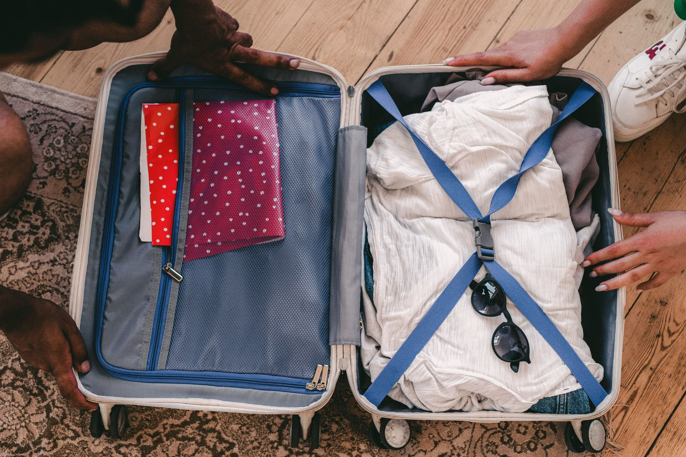

Travel writing is coy about money, which is strange, because money is the single
constraint every reader shares. So: here is a week, itemised, from a trip we
actually took, with nothing rounded in our favour.

Two people, seven nights, southern Europe, no flights included because flight
prices are noise and depend entirely on where you start.

_The bag that avoided two checked-baggage fees, which is a budget line in itself. Photo: Shvets Production._

## The ledger

- **Accommodation, 7 nights:** the largest line and the least surprising.
  Booked eleven weeks out, mid-range, two of the seven nights notably cheaper
  because they were midweek.
- **Food:** roughly a third of accommodation. One proper dinner, the rest
  markets and counters.
- **Local transport:** less than a tenth. Almost everything was walked.
- **Entry tickets:** more than we expected, by a lot. Six sites at fifteen to
  twenty each, twice, adds up faster than any meal.
- **The unbudgeted line:** a taxi at midnight, a pharmacy, and a replacement
  charger.

> The two things that blow a travel budget are tickets and arrival days. Nobody
> plans the first evening, and the first evening is always the most expensive
> one of the trip.

## What we would change

Buy the city pass if there is one and you will do more than three things. Eat
the big meal at lunch, where the same kitchen charges less. And put fifty a week
aside for the taxi you swore you would not take, because you will take it.
