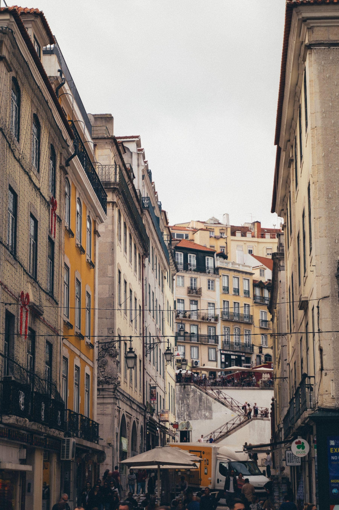

The tiles get photographed as pattern, which is fair, and understood as
decoration, which is wrong. The reason a Lisbon facade is tiled is that it rains
sideways off the Atlantic for four months a year and a glazed surface sheds
water where render does not.

They also insulate. A tiled south wall is measurably cooler inside than a
painted one, which matters in a city that hits forty degrees in August and was
built before anybody had the alternative.

_Nineteenth century, machine-made, and still doing its job. Photo: Taras Chuiko._

## How to read a facade

- **Hand-painted, irregular, blue and white:** likely eighteenth century, and
  probably moved here from somewhere else.
- **Repeating small pattern, sharp edges:** industrial, nineteenth century,
  when the factories at Sacavém made them by the million.
- **Relief tiles that catch shadow:** late nineteenth and early twentieth
  century, and the most Lisbon of the lot.
- **Bright, large, flat panels:** twentieth century, often metro stations, and
  frequently by named artists.

> A building with its tiles stripped is not a building that went out of fashion.
> It is usually a building somebody sold the tiles off, which is illegal and
> still happens.

## Where to look

Not the museum first. Walk Campo de Ourique or Graça and look at ordinary
housing, then go to the Museu Nacional do Azulejo and the whole thing will mean
something. Doing it the other way round produces a pleasant morning and very
little understanding.
